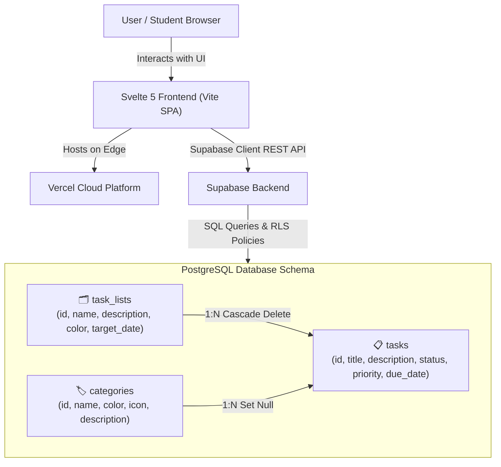

# 📝 TO-DO LIST MANAGEMENT SYSTEM

A production-grade, full-featured **To-Do List Management System** individual project designed for streamlined task tracking, category classification, and milestone-driven task organization.

Built using the finalized tech stack: **Svelte + Supabase + PostgreSQL + Vercel**.

---

## 🛠️ Technology Stack

| Component | Technology | Role & Architecture |
|---|---|---|
| **Frontend** | **Svelte 5 + Vite + Tailwind CSS** | Reactive SPA with runes, multi-layout views (List, Kanban Board, Grid), dynamic progress meters, and modal dialogs |
| **Backend** | **Supabase** | Client API layer, real-time query interface, authentication readiness, and relational database abstraction |
| **Database** | **PostgreSQL** | Relational schema with foreign key constraints, status validation rules, and automated timestamp triggers |
| **Deployment** | **Vercel** | Edge-hosted static delivery with SPA rewrites (`vercel.json`) and instant global CDN distribution |

---

## 🏛️ System Architecture



---

## 📦 System Modules & CRUD Operations

### A. Task Management

**CRUD Operations:**
- **Create**: Add new tasks with Title, Description, Status, Priority, Due Date & Time, Category assignment, and Task List grouping.
- **Read**:
  - Multi-layout display: **List View**, **Kanban Board View** (organized into 4 status columns), and **Grid Cards View**.
  - Real-time instant search across Title, Description, Category names, and Task List names.
  - Quick-filter tabs: `All Tasks`, `Pending`, `In Progress`, `Completed`, `Overdue`.
  - Advanced filtering by Category, Task List, Priority, and custom sorting (Due Date, Priority, Created At, Title).
  - Detailed task modal with deadline countdown and timestamp tracking.
- **Update**:
  - Edit full task specifications (title, notes, due date, category, list).
  - 1-click status cycle and checkbox completion toggle.
  - Direct status selector inside task rows and kanban boards.
  - Automatic overdue detection: dynamically flags past-due tasks as `Overdue`.
- **Delete**:
  - Delete individual tasks with safe confirmation modal.
  - 1-click **Clear Completed** batch removal.

**Task Statuses:**
1. `Pending`: Task is queued and ready to start.
2. `In Progress`: Task is actively being worked on.
3. `Completed`: Task has been finished (stamps `completed_at`).
4. `Overdue`: Deadline has elapsed while uncompleted.

---

### B. Task Category Management

**CRUD Operations:**
- **Create**: Add new task categories with Name, Description, Hex Color Swatch, and Icon tag.
- **Read**:
  - View and search categories in card layouts.
  - Real-time active task counters per category (Active, Done, Overdue).
  - 1-click "View Tasks" to filter tasks under that category.
- **Update**: Edit category titles, colors, icons, and descriptions.
- **Delete**: Safe category deletion with automatic graceful detachment (tasks are retained and reassigned to Uncategorized).

---

### C. Task Organization Management

**CRUD Operations:**
- **Create**: Create structured Task Lists and Project workspaces (e.g., "Semester Project Sprints", "Daily Routine & Focus", "Health & Wellness Habits") with target deadlines.
- **Read**:
  - View all task lists and their associated task records.
  - Completion progress bars showing the percentage (%) of completed tasks.
  - Status metric badges (Active, Done, Overdue).
- **Update**: Update task list name, description, accent color, icon, and target completion date.
- **Delete**: Remove task lists with cascade deletion of associated task records.

**Task Organization Features:**
- **Task Priority**: `Low`, `Medium`, `High`, `Urgent` with color-coded badges and priority weight sorting.
- **Due Dates & Deadlines**: Precise date & time picker, humanized countdowns (*"2 days left"*, *"5h left"*, *"3d overdue"*).
- **Task Descriptions**: Multi-line descriptions and notes.
- **Category Assignment**: Direct category tagging with color identifiers.
- **Completion Tracking**: Real-time progress computation, completion percentages, and visual meters.

---

## 🗄️ PostgreSQL Database Schema

The database schema is located at [`supabase/schema.sql`](./supabase/schema.sql):

```sql
-- 1. TASK LISTS
CREATE TABLE public.task_lists (
  id UUID PRIMARY KEY DEFAULT gen_random_uuid(),
  name TEXT NOT NULL,
  description TEXT,
  color TEXT DEFAULT '#3b82f6',
  icon TEXT DEFAULT 'folder',
  target_date DATE,
  is_archived BOOLEAN DEFAULT FALSE,
  created_at TIMESTAMPTZ DEFAULT NOW(),
  updated_at TIMESTAMPTZ DEFAULT NOW()
);

-- 2. TASK CATEGORIES
CREATE TABLE public.categories (
  id UUID PRIMARY KEY DEFAULT gen_random_uuid(),
  name TEXT NOT NULL UNIQUE,
  color TEXT DEFAULT '#10b981',
  icon TEXT DEFAULT 'tag',
  description TEXT,
  created_at TIMESTAMPTZ DEFAULT NOW()
);

-- 3. TASKS
CREATE TABLE public.tasks (
  id UUID PRIMARY KEY DEFAULT gen_random_uuid(),
  title TEXT NOT NULL,
  description TEXT,
  status TEXT NOT NULL DEFAULT 'Pending' 
    CHECK (status IN ('Pending', 'In Progress', 'Completed', 'Overdue')),
  priority TEXT NOT NULL DEFAULT 'Medium' 
    CHECK (priority IN ('Low', 'Medium', 'High', 'Urgent')),
  due_date TIMESTAMPTZ,
  category_id UUID REFERENCES public.categories(id) ON DELETE SET NULL,
  list_id UUID REFERENCES public.task_lists(id) ON DELETE CASCADE,
  completed_at TIMESTAMPTZ,
  created_at TIMESTAMPTZ DEFAULT NOW(),
  updated_at TIMESTAMPTZ DEFAULT NOW()
);

-- Indexes for performance
CREATE INDEX idx_tasks_status ON public.tasks(status);
CREATE INDEX idx_tasks_priority ON public.tasks(priority);
CREATE INDEX idx_tasks_due_date ON public.tasks(due_date);
CREATE INDEX idx_tasks_list_id ON public.tasks(list_id);
CREATE INDEX idx_tasks_category_id ON public.tasks(category_id);
```

---

## 🚀 Getting Started

### 1. Installation

Navigate into the project directory and install dependencies:

```bash
cd to-do-list
npm install
```

### 2. Configure Environment Variables (Optional for Live Supabase)

Copy `.env.example` to `.env`:

```bash
cp .env.example .env
```

Set your Supabase credentials:

```env
VITE_SUPABASE_URL=https://your-project.supabase.co
VITE_SUPABASE_ANON_KEY=your-anon-key-here
```

> **Note**: If Supabase environment variables are omitted, the application runs in **Local Demo Mode** using browser `localStorage` with full mock persistence and interactive seed data.

### 3. Run Development Server

```bash
npm run dev
```

Open your browser at `http://localhost:5173`.

### 4. Build for Production

```bash
npm run build
```

Production static assets will be output to the `dist/` folder.

---

## ☁️ Vercel Deployment

This project includes [`vercel.json`](./vercel.json) pre-configured with SPA route rewrites:

```json
{
  "buildCommand": "npm run build",
  "outputDirectory": "dist",
  "rewrites": [
    {
      "source": "/(.*)",
      "destination": "/index.html"
    }
  ]
}
```

### Deploying via Vercel CLI:
```bash
npm i -g vercel
vercel
```

Add your `VITE_SUPABASE_URL` and `VITE_SUPABASE_ANON_KEY` under the Project Settings &rarr; Environment Variables in the Vercel Dashboard.
